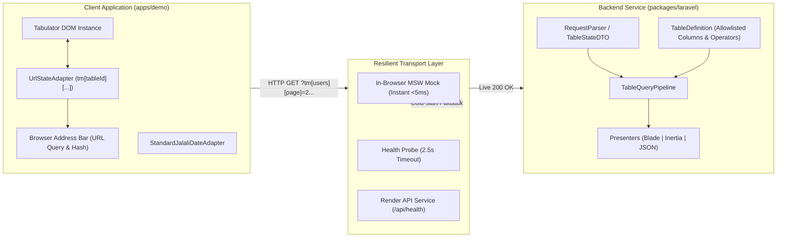

# Tabulator Manager

[](https://www.npmjs.com/package/@tabulator-manager/core)
[](https://packagist.org/packages/tabulator-manager/laravel)
[](LICENSE)
[](https://github.com/tabulator-manager/tabulator-manager/actions)
[](https://github.com/tabulator-manager/tabulator-manager)
[](https://sm-me-dev.github.io/tabulator-manager/)

A modern, production-grade monorepo delivering decoupled, transport-agnostic table state coordination for **Tabulator** and seamless, database-agnostic query processing in **Laravel 11 & 12**.

---

## Architecture Overview



- **[`@tabulator-manager/core`](file:///home/sm-me/Codes/Typescript/tabulator-manager/packages/core)**: Framework-independent TypeScript core providing non-destructive per-table URL state synchronization (`tm[tableId][...]`), strict Jalali date parsing with Persian digits normalization, and a clean Tabulator mount controller. Bundled as ESM, CJS, and IIFE with clean `.d.ts` declarations.
- **[`tabulator-manager/laravel`](file:///home/sm-me/Codes/Typescript/tabulator-manager/packages/laravel)**: Database-agnostic Eloquent query pipeline, strongly typed request DTO parsing, strict column allowlisting, and unified presenters for Blade, Inertia.js, and REST APIs.
- **[`apps/demo`](file:///home/sm-me/Codes/Typescript/tabulator-manager/apps/demo)**: Interactive Linear/Raycast dark-mode preview app with instant Mock Service Worker (MSW) fallback and Render backend cold-start resilience.
- **[`apps/laravel-demo`](file:///home/sm-me/Codes/Typescript/tabulator-manager/apps/laravel-demo)**: Dockerized Laravel 12 API service tailored for Render Free deployment.

---

## Quick Installation

### TypeScript Core (npm)

```bash
# pnpm
pnpm add @tabulator-manager/core tabulator-tables

# npm
npm install @tabulator-manager/core tabulator-tables

# yarn
yarn add @tabulator-manager/core tabulator-tables
```

### Laravel Package (Composer)

```bash
composer require tabulator-manager/laravel
```

Optionally publish the configuration file:

```bash
php artisan vendor:publish --tag=tabulator-manager-config
```

---

## TypeScript Core Quickstart

```typescript
import { TabulatorFull as Tabulator } from "tabulator-tables";
import { mountTable, UrlStateAdapter, readTableState } from "@tabulator-manager/core";

// 1. Initialize URL state adapter scoped strictly to "users" table
const urlAdapter = new UrlStateAdapter("users");
const initialState = urlAdapter.current();

// 2. Mount table instance with authoritative server-side pagination
const table = mountTable({
  element: "#users-table",
  Tabulator,
  columns: [
    { title: "ID", field: "id", width: 70 },
    { title: "Name", field: "name", headerSort: true },
    { title: "Score", field: "score", headerSort: true },
    { title: "Status", field: "status" },
  ],
  options: {
    pagination: true,
    paginationMode: "remote",
    filterMode: "remote",
    sortMode: "remote",
    paginationSize: initialState.size,
    paginationInitialPage: initialState.page,
    ajaxURL: "/api/users",
    ajaxURLGenerator: (url, config, params) => {
      // Sync Tabulator pagination & sorting to tm[users] query parameters
      const current = readTableState("users");
      urlAdapter.update({
        page: params.page || current.page,
        size: params.size || current.size,
        sort: current.sort,
        filters: current.filters,
      }, "replace");

      return `/api/users?${window.location.search.replace(/^\?/, "")}`;
    },
    ajaxResponse: (url, params, response) => {
      // Server-side pagination is authoritative
      return {
        data: response.data,
        last_page: response.meta.last_page,
      };
    },
  },
});
```

---

## Laravel Quickstart

### 1. Controller Implementation

```php
namespace App\Http\Controllers;

use App\Models\User;
use Illuminate\Http\Request;
use TabulatorManager\Laravel\TableDefinition;
use TabulatorManager\Laravel\RequestParser;
use TabulatorManager\Laravel\TableQueryPipeline;
use TabulatorManager\Laravel\JsonPresenter;
use TabulatorManager\Laravel\BladePresenter;
use TabulatorManager\Laravel\InertiaPresenter;

class UserController extends Controller
{
    private function getTableDefinition(): TableDefinition
    {
        return new TableDefinition(
            queryFactory: fn () => User::query(),
            columns: [
                'id' => ['column' => 'id', 'sortable' => true],
                'name' => ['column' => 'name', 'sortable' => true, 'operators' => ['contains', '=']],
                'score' => ['column' => 'score', 'sortable' => true, 'operators' => ['>=', '<=', '=', '!=']],
                'status' => ['column' => 'status', 'sortable' => true, 'operators' => ['=']],
                'created_at' => ['column' => 'created_at', 'sortable' => true, 'operators' => ['=']],
            ],
            stableOrderColumn: 'id',
            defaultPageSize: 20,
            maxPageSize: 100,
            tableId: 'users'
        );
    }

    // JSON API Response
    public function index(Request $request, RequestParser $parser, TableQueryPipeline $pipeline, JsonPresenter $presenter)
    {
        $definition = $this->getTableDefinition();
        $state = $parser->parseFromRequest($request, $definition, 'users');
        $result = $pipeline->run($definition, $state);

        return $presenter->present($result);
    }

    // Blade View Hydration
    public function showBlade(Request $request, RequestParser $parser, TableQueryPipeline $pipeline, BladePresenter $presenter)
    {
        $definition = $this->getTableDefinition();
        $state = $parser->parseFromRequest($request, $definition, 'users');
        $tableData = $presenter->present($pipeline->run($definition, $state));

        return view('users.index', ['table' => $tableData]);
    }

    // Inertia.js Page Response
    public function showInertia(Request $request, RequestParser $parser, TableQueryPipeline $pipeline, InertiaPresenter $presenter)
    {
        $definition = $this->getTableDefinition();
        $state = $parser->parseFromRequest($request, $definition, 'users');
        $result = $pipeline->run($definition, $state);

        return $presenter->present('Users/Index', $result);
    }
}
```

---

## Jalali Calendar & Persian Digits Support

Strict compliance with the date format contract (`YYYY-MM-DD` / `YYYY/MM/DD`), range separator (`" تا "`), and normalization of Persian (`۰-۹`) and Arabic (`٠-٩`) digits.

```typescript
import { StandardJalaliDateAdapter, normalizeDigits } from "@tabulator-manager/core";

const adapter = new StandardJalaliDateAdapter();

// 1. Digits Normalization
normalizeDigits("۱۴۰۳/۰۸/۱۵"); // => "1403/08/15"

// 2. Range Splitting
const [from, to] = adapter.splitRange("۱۴۰۳/۰۱/۰۱ تا ۱۴۰۳/۰۶/۳۰");
// from => "1403/01/01"
// to   => "1403/06/30"

// 3. Bidirectional Calendar Conversions
adapter.toGregorian("1403/01/01"); // => "2024-03-20"
adapter.toJalali("2024-03-20");    // => "1403/01/01"
```

---

## Legacy Migration Guide

Legacy Blade views that relied on `new window.TabulatorManager(selector, url, options)` can continue operating using our backward-compatibility shim, which logs an explicit `@deprecated` console warning:

```html
<!-- Legacy Plain Script / IIFE Usage -->
<script src="https://unpkg.com/tabulator-tables@6.3.0/dist/js/tabulator.min.js"></script>
<script src="https://unpkg.com/@tabulator-manager/core/dist/index.global.js"></script>

<script>
  // Deprecated constructor mapping seamlessly to mountTable:
  const table = new window.TabulatorManager("#my-table", "/api/users", {
    data: initialData,
    columns: [
      { title: "Name", field: "name" },
      { title: "Role", field: "role" }
    ]
  });
</script>
```

### Upgrading to Modern ESM:

```diff
- const table = new TabulatorManager("#my-table", "/api/data", { columns, data });
+ import { TabulatorFull as Tabulator } from "tabulator-tables";
+ import { mountTable } from "@tabulator-manager/core";
+ 
+ const table = mountTable({
+   element: "#my-table",
+   Tabulator,
+   columns,
+   data
+ });
```

---

## Documentation Index

- **[API Reference](file:///home/sm-me/Codes/Typescript/tabulator-manager/docs/api-reference.md)**: Exhaustive documentation for all TypeScript classes, functions, and Laravel pipeline components.
- **[URL State Contract](file:///home/sm-me/Codes/Typescript/tabulator-manager/docs/url-state-contract.md)**: Specification of the `tm[tableId][...]` namespaced state standard and URL parameter preservation.
- **[Jalali Calendar Guide](file:///home/sm-me/Codes/Typescript/tabulator-manager/docs/jalali-calendar.md)**: Date contracts, range parsing, and Persian digit normalization rules.
- **[Publishing & CI/CD Guide](file:///home/sm-me/Codes/Typescript/tabulator-manager/docs/publishing-guide.md)**: npm Trusted Publishing (OIDC & provenance) and Packagist release automation.
- **[Contributing Guide](file:///home/sm-me/Codes/Typescript/tabulator-manager/CONTRIBUTING.md)**: Local development setup, testing standards, and changeset guidelines.

---

## License

This project is open-sourced under the [MIT License](file:///home/sm-me/Codes/Typescript/tabulator-manager/LICENSE).
