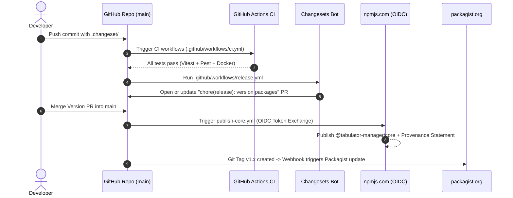

# Publishing & CI/CD Guide

Comprehensive release guide for `@tabulator-manager/core` (NPM) and `tabulator-manager/laravel` (Packagist).

---

## 1. NPM Trusted Publishing & Cryptographic Provenance

In accordance with 2026 security best practices, `@tabulator-manager/core` uses **npm Trusted Publishing** (OIDC-based tokenless authentication) rather than persistent, long-lived API tokens.

### How It Works
1. During the `.github/workflows/publish-core.yml` run, GitHub generates a short-lived OIDC JWT token.
2. The `id-token: write` permission authorizes the runner.
3. npm exchanges the JWT token for a temporary publishing ticket verified against the registered GitHub repository.
4. With `--provenance`, npm binds the published package artifacts to the exact Git commit, GitHub Actions workflow file, and runner environment.

### Setting Up Trusted Publishing on npmjs.com
1. Navigate to your package settings on [npmjs.com](https://www.npmjs.com/).
2. Select **Publishing Access** &gt; **Trusted Publishers**.
3. Add a new **GitHub Actions** publisher:
   - **Repository Owner**: `tabulator-manager`
   - **Repository Name**: `tabulator-manager`
   - **Workflow filename**: `publish-core.yml`
   - **Environment name**: (Leave empty or set to `production`)
4. Once added, releases published from `.github/workflows/publish-core.yml` will automatically authenticate without secrets!

---

## 2. Packagist & Composer Publishing

### Registering on Packagist
1. Log in to [Packagist.org](https://packagist.org/).
2. Click **Submit** and enter the repository URL:
   `https://github.com/tabulator-manager/tabulator-manager`
3. Packagist will read `packages/laravel/composer.json` and register `tabulator-manager/laravel`.

### Automated Webhook Integration
To automatically update Packagist whenever a release or Git tag is pushed:
1. In your Packagist account profile, obtain your **API Token**.
2. Go to your GitHub repository **Settings** &gt; **Webhooks** &gt; **Add webhook**:
   - **Payload URL**: `https://packagist.org/api/github?username=YOUR_USERNAME`
   - **Content type**: `application/json`
   - **Secret**: Your Packagist API Token
   - **Events**: Just the `push` event.
3. Every Git tag push (`git push --tags`) will trigger Packagist to build the new release within seconds.

---

## 3. Automated Release Lifecycle

1. **Feature Development**: Developers make changes and run `pnpm changeset`.
2. **Pull Request**: Monorepo CI runs all Vitest and Pest suites across PHP 8.2–8.4 and Node LTS.
3. **Automated Version PR**: Changesets aggregates commits into a single version PR with updated changelogs.
4. **Merge & Release**: Merging the Version PR generates Git tags (`v*`), publishing `@tabulator-manager/core` to npm via OIDC and notifying Packagist.
